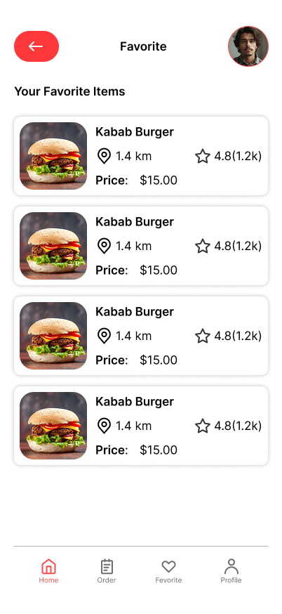
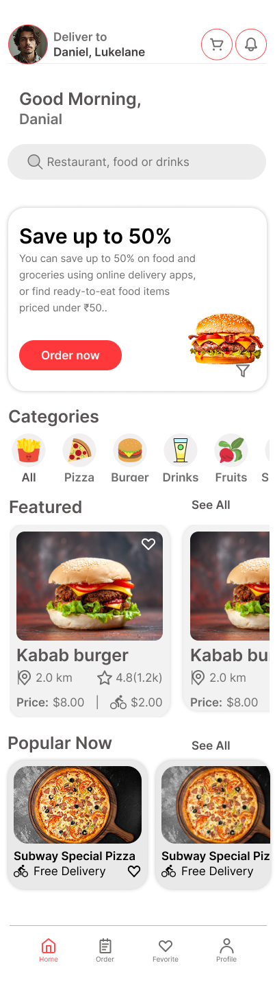
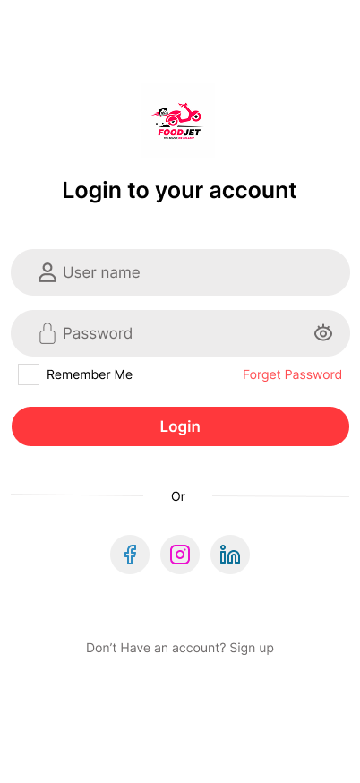
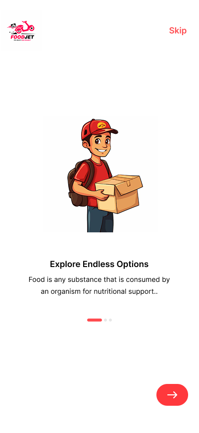
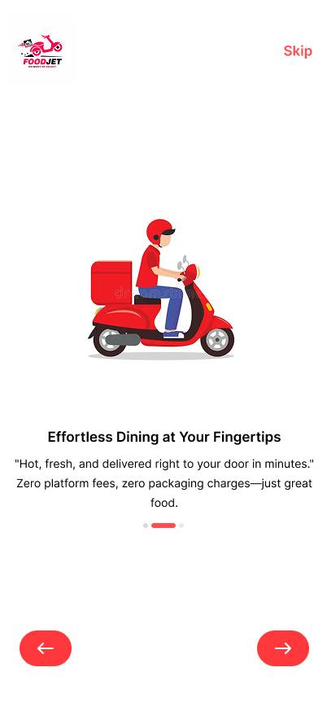
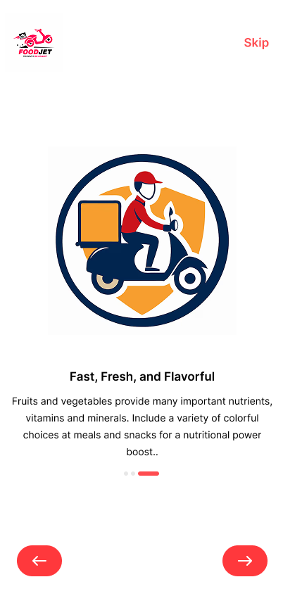
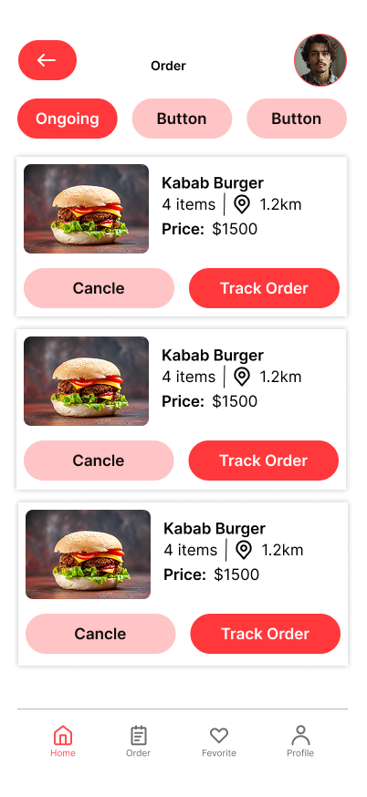
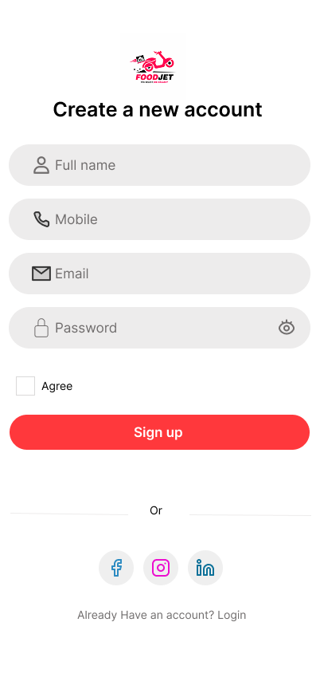

# 🍔 Food Deliver – Mobile App UI/UX Design

### Designed by Shubhi Shrivastava

A modern and user-friendly Food Delivery Mobile App UI/UX design created in Figma. This project focuses on delivering a smooth, visually appealing and convenient food ordering experience.

---

## 🎨 Project Overview

This design showcases a complete food delivery app experience, from onboarding and user authentication to browsing favourite items and placing orders.

## 📱 Design Screens

The project includes 8 carefully designed screens:

1. 🏠 Home Screen
2. ❤️ Favourite Screen
3. 🔐 Login Screen
4. 🚀 Onboarding Screen 1
5. 🚀 Onboarding Screen 2
6. 🚀 Onboarding Screen 3
7. 🛒 Order Screen
8. ✨ Signup Screen

---

## 🖼️ Screenshots

### 01. Favourite Screen

### 02. Home Screen

### 03. Login Screen

### 04. Onboarding Screen 1

### 05. Onboarding Screen 2

### 06. Onboarding Screen 3

### 07. Order Screen

### 08. Signup Screen

---

## 🔗 View Full Design in Figma

[✨ Click Here to Explore the Complete Food Delivery App Design](https://www.figma.com/design/gee9L72rsVM8PZq9pRscHu/Food-deliver-app?node-id=89-1089&t=TSwq1YbNCVKtVDfL-1)

---

## 🛠️ Tools & Skills

- Figma
- UI/UX Design
- Mobile App Design
- Wireframing
- Prototyping
- User Interface Design

---

## 👩‍💻 Designer

**Shubhi Shrivastava**

UI/UX Designer | Creative Thinker | Design Enthusiast

---

⭐ Thank you for visiting my project!
